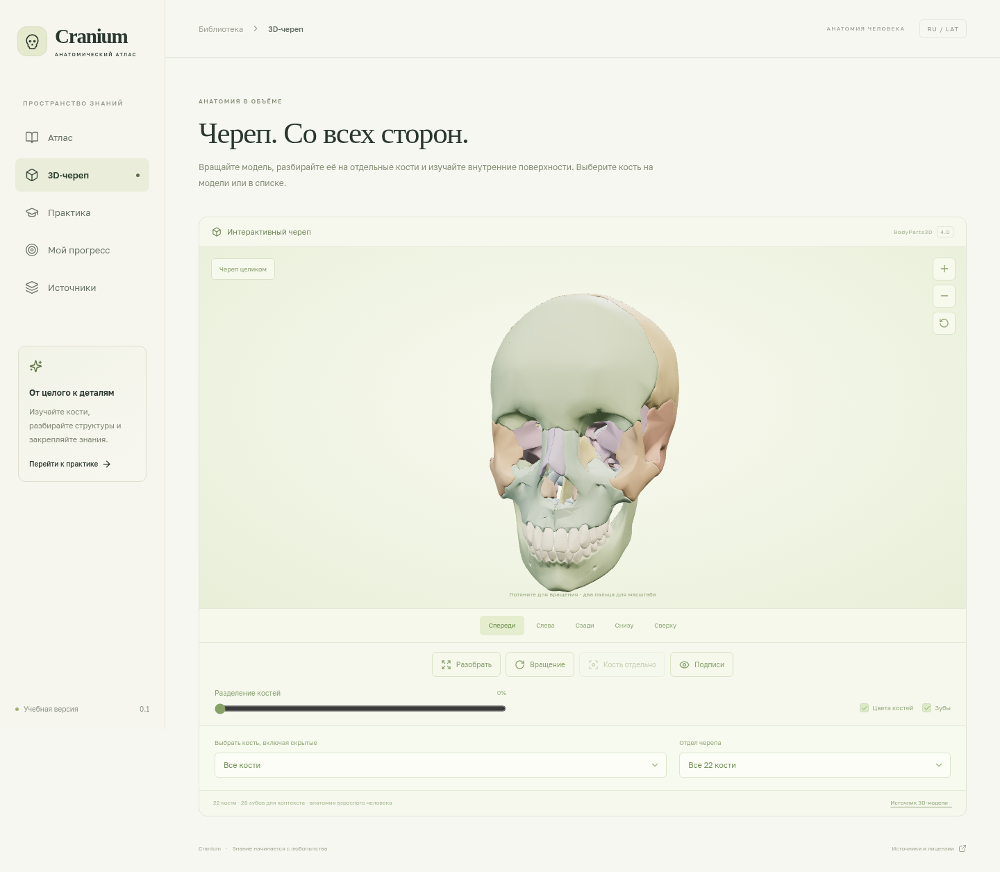
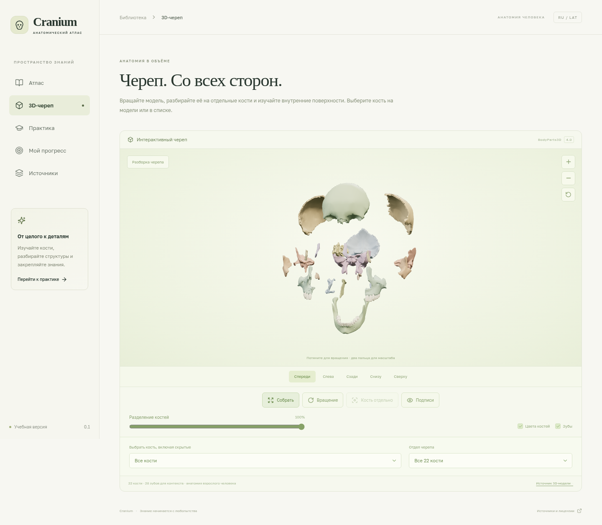

# Cranium — Telegram Mini App: 3D-атлас черепа

Русскоязычный учебный **3D-атлас с анимациями** для браузера и Telegram. Атлас и бот запускаются в одном Docker-контейнере на **bothost.ru**. GitHub Pages остаётся дополнительным вариантом размещения сайта. База данных и платный API не нужны.

## Предпросмотр

Снимки работающей тестовой сборки с реальной WebGL-моделью BodyParts3D. В приложении доступны вращение, разборка, сборка и выбор отдельной кости. Публикация на внешнем хостинге проверяется отдельно.





## Что работает

- Реальная анатомическая 3D-геометрия **BodyParts3D 4.0**: 22 отдельные кости и 28 зубов для контекста, 166 838 треугольников, 3,7 МБ данных. Это не имитация объёма плоским изображением.
- Вращение мышью или пальцем, масштабирование, пять ракурсов камеры, выбор каждой кости и отдельный просмотр правых/левых костей. Выбранная сторона сохраняется при переходе в карточку.
- **Анимации разборки, обратной сборки, вращения и переходов камеры**; ползунок степени разделения, цвета костей, подписи, фильтр мозгового/лицевого отдела. Учитывается системная настройка уменьшения движения.
- Все 22 кости взрослого черепа в 14 карточках типов: 8 мозговых и 14 лицевых, с корректным учётом парности.
- 92 структуры с интерактивными 3D-метками: выбор из списка или по номеру на модели, русский/латинский термин и плавное наведение камеры. Координаты адаптированы из Z-Anatomy с сохранённой атрибуцией и статистикой регистрации.
- 226 основных именованных структур с русскими и латинскими названиями, группами и пояснениями.
- Три дополнительные схематические навигационные проекции, поиск по костям и структурам, фильтры отделов, избранное.
- 11 оригинальных медицинских иллюстраций OpenStax и переключение проекций в карточках.
- 54 интерактивных маркера на основных изображениях семи типов костей. Подпись связана с полным списком структур. Для остальных структур доступно текстовое пояснение; маркеры не приписывают невидимым поверхностям ложные координаты.
- Тесты по всему черепу, отделу или отдельной кости: терминология и распознавание кости по описанию. Случайный порядок, разбор ответа, результат и повторение ошибок.
- Локальное сохранение избранного, изученных костей и последних 30 результатов. Между устройствами данные не синхронизируются.
- Telegram Web App SDK, встроенная кнопка «Назад», адаптивный интерфейс и работа в обычном браузере.
- Python-бот: `/start`, `/atlas`, `/help`, кнопка Mini App и меню бота; polling без внешних Python-зависимостей.

В **3D каждая из 22 костей** доступна отдельно. Для дополнительных **2D-иллюстраций** отдельные исходные изображения есть для височной, клиновидной, решётчатой костей, верхней и нижней челюстей; остальные показаны на проекциях черепа. Учебный каталог не претендует на исчерпывающую номенклатуру всех вариантов строения. В 3D подписаны все кости и 92 структуры; остальные 134 структуры доступны именованным списком с пояснениями. Дополнительно 54 ориентира имеют маркеры на 2D-иллюстрациях. Регистрация 3D-меток — учебная адаптация исходных авторских точек, а не экспертное подтверждение каждой координаты. Подробнее: [анатомические источники и границы версии](docs/ANATOMY.md).

## Запуск целиком на BotHost

Пошаговая инструкция по полям присланной формы: **[docs/BOTHOST.md](docs/BOTHOST.md)**.

Укажите репозиторий `https://github.com/optimur24-gif/starosta-bo.git`, ветку `main`, главный файл **`app.py`**, включите **собственный Dockerfile** и веб-доступ с портом **`3000`**. Контейнер сам соберёт и раздаст атлас. Кастомный домен можно оставить пустым для автоматического назначения.

Задайте секрет `BOT_TOKEN`. При первом запуске `MINI_APP_URL` можно оставить пустым: сайт запустится и без него. Когда BotHost выдаст публичный HTTPS-адрес, откройте его, затем сохраните этот адрес в `MINI_APP_URL` и перезапустите контейнер. Бот настроит кнопку «Атлас». Если до этого использовался адрес GitHub Pages, замените его адресом BotHost.

После обновления проекта требуется пересборка из актуальной ветки `main`, чтобы получить новый Dockerfile. Один перезапуск прежнего образа не загружает новые файлы.

## Локальный запуск

Нужны Node.js **22.12+** (рекомендуется 24, `.nvmrc`) и Python **3.11+** (проверено на 3.12).

```bash
cd /workspace/starosta-bo
npm ci
npm run dev
```

Для собранной версии:

```bash
npm run build
npm start
```

Сервер Python слушает порт `3000`, при необходимости задайте `PORT`. Проверка доступности: `GET /healthz`. Сервер раздаёт только `dist/`, не исходники и не `.env`. `npm start` использует `app.py --web-only` и не обращается к Telegram даже при наличии переменных бота. Для сайта вместе с ботом используйте `npm run host` или `python3 app.py`.

```bash
npm run check      # данные, генератор тестов, хранилище, Python-бот, TypeScript, сборка
npm run test:e2e   # браузерные сценарии на компьютере и телефоне
```

Для 3D нужен WebGL 2 — он поддерживается современными браузерами и актуальными Telegram WebView. В случае отсутствия поддержки приложение сообщает об этом и сохраняет доступ к иллюстрациям и тексту.

Playwright использует `/usr/bin/chromium`, если он установлен. В другом окружении выполните `npx playwright install --with-deps chromium`. Можно задать `PLAYWRIGHT_CHROMIUM_EXECUTABLE`. В CI используется программный WebGL-рендер SwiftShader: тесты проверяют реальные отрисованные треугольники и изменения положения объектов, а не только наличие canvas.

3D-геометрия хранится в репозитории и не загружается с внешнего CDN. Библиотека Three.js подгружается отдельным модулем. Для проверки или восстановления данных: `python3 scripts/import-models.py --verify-only` или `python3 scripts/import-models.py`. Восстановление проверяет SHA-256 и Git blob ID каждого исходного файла и итогового массива.

## Дополнительно: публикация сайта через GitHub Pages

Workflow уже подготовлен: [.github/workflows/pages.yml](.github/workflows/pages.yml). Он проверяет приложение, собирает его для пути репозитория, выполняет браузерные тесты с этим путём и публикует `dist/`.

1. Код уже отправлен в ветку `main` репозитория `optimur24-gif/starosta-bo`. Проверки [CI](https://github.com/optimur24-gif/starosta-bo/actions/runs/39250562212) прошли. Сборка и браузерные проверки [workflow публикации](https://github.com/optimur24-gif/starosta-bo/actions/runs/39250562361) тоже прошли, но задание `deploy` остановилось: Pages ещё не включён (`Get Pages site failed: Not Found`).

2. В GitHub откройте **Settings → Pages → Build and deployment → Source → GitHub Actions**. Для частного репозитория проверьте доступность Pages в вашем тарифе.
3. В **Actions → Deploy test Mini App to GitHub Pages** запустите workflow с ветки `main` либо повторите его после включения Pages.
4. Дождитесь успешного задания `deploy`. Используйте **адрес из результата deployment**, а не предполагаемый адрес до публикации.

Ожидаемый адрес при стандартной конфигурации: `https://optimur24-gif.github.io/starosta-bo/`. Он не считается опубликованным или проверенным до успешного workflow. Для другого имени репозитория workflow подставит путь автоматически. При использовании собственного домена измените `BASE_PATH` на `/` и настройте домен в Pages.

Проверенная локальная имитация пути Pages:

```bash
BASE_PATH=/starosta-bo/ npm run build
E2E_BASE_PATH=/starosta-bo/ npm run test:e2e
```

## BotHost и Telegram

Основной вариант с сайтом и ботом в одном контейнере: **[docs/BOTHOST.md](docs/BOTHOST.md)**. Дополнительный вариант с отдельным сайтом на Pages: [docs/DEPLOYMENT.md](docs/DEPLOYMENT.md).

На хостинге задайте:

| Переменная     | Значение                                                                    |
| -------------- | --------------------------------------------------------------------------- |
| `BOT_TOKEN`    | Секретный токен BotFather; вводится только в защищённые переменные хостинга |
| `MINI_APP_URL` | Публичный HTTPS-адрес, выданный BotHost; при отдельном сайте — его адрес    |

Основная команда запуска: **`python app.py`**. Dockerfile собирает атлас и запускает эту команду. Python-пакеты не требуются. `requirements.txt` оставлен для совместимости с установщиками хостинга.

Веб-сервер работает в отдельном потоке единого Python-процесса. Отсутствие настроек бота или ошибка Telegram не мешают открыть атлас. Один токен должен обслуживаться одним polling-процессом. Существующий webhook автоматически не удаляется. Для отдельного бота с внешним сайтом сохраняется команда `python main.py`.

Файл `.env.example` — образец, а не автоматически загружаемый файл. На BotHost задавайте переменные в панели; при локальном запуске экспортируйте их в окружение. `python main.py --check` проверяет учётную запись и отсутствие webhook без изменения команд и меню.

## Статус проверки

Команды проверки покрывают фронтенд, данные, целостность 3D-геометрии, Python-бота, HTTP-сервер и браузерные сценарии на компьютере/телефоне. В CI браузерные сценарии обращаются к собранному Docker-контейнеру. Проверки Telegram используют имитацию API; доступ к аккаунту BotHost и его внешнему HTTPS-адресу в этой сессии отсутствует. Секретов в репозитории нет. Выполненные проверки и ограничения: [docs/VALIDATION.md](docs/VALIDATION.md).

Прямое чтение сайтов bothost.ru, FIPAT и Telegram из этой машины ограничено сетевой политикой (HTTP 403 прокси). Официальный раздел и изображения OpenStax изучены через его GitHub-репозиторий. Поэтому точные названия разделов текущей панели BotHost и работа её импорта не заявлены как проверенные. Используются стандартный Python-процесс и официальный формат Telegram `web_app`.

## Структура

```text
src/data/anatomy.ts       — кости, структуры и источники
src/data/annotations.ts   — координаты видимых ориентиров
src/data/projections.ts   — дополнительные проекции
src/components/           — схема черепа и подписанные иллюстрации
src/components/SkullViewer.tsx — интерфейс интерактивного 3D-просмотра
src/lib/skull-scene.ts    — Three.js, анимации, выбор и изоляция костей
src/lib/quiz.ts           — генератор вопросов
src/lib/storage.ts        — локальный прогресс
src/lib/telegram.ts       — интеграция Telegram Web App
public/illustrations/     — оригиналы OpenStax, лицензия, SHA-256
public/models/           — 3D-геометрия, FJ/FMA IDs, лицензии и SHA-256
scripts/import-models.py — воспроизводимая проверка/загрузка 3D-данных
main.py                  — бот для BotHost
app.py                   — единый HTTP-сервер и запуск бота
Dockerfile               — сборка атласа и Python-контейнер для BotHost
tests/                   — проверки логики, бота и браузерных сценариев
```

Код — [MIT](LICENSE). 3D-геометрия BodyParts3D 4.0 — [CC BY 4.0, происхождение и атрибуция](public/models/ATTRIBUTION.md). Отдельный адаптированный набор 3D-меток Z-Anatomy — CC BY-SA 4.0. Учебные тексты и собственные схемы — [CC BY-NC-SA 4.0](https://creativecommons.org/licenses/by-nc-sa/4.0/). Изображения OpenStax имеют свою [лицензию](public/illustrations/OPENSTAX-LICENSE.txt); исходные файлы сохранены без изменений. Приложение не является официальным продуктом указанных организаций.
